<div align="center">



[](https://arxiv.org/abs/2510.04573)
[](https://arxiv.org/abs/2602.01705)
[](https://huggingface.co/mk322/LaDiR-Code-8B)
[](https://huggingface.co/mk322/LaDi-RL-Code-8B)

</div>

Official code for two papers:

- **[LaDiR: Latent Diffusion Enhances LLMs for Text Reasoning](https://arxiv.org/abs/2510.04573)** (ICLR 2026).
  An LLM reasons in a continuous latent space: a VAE compresses a reasoning chain into 64 latent tokens, the LLM
  generates this latent block with flow matching, then decodes the answer conditioned on it.
- **[LaDi-RL: Latent Diffusion Reasoning Prevents Entropy Collapse in Reinforcement Learning](https://arxiv.org/abs/2602.01705)**.
  Reinforcement learning on top of LaDiR that optimizes both the latent reasoning and the decoded answer.

| | |
|---|---|
| `ladir/`, `vae/`, `sft/` | LaDiR model, VAE and SFT training |
| `rl/` | LaDi-RL training |
| `eval/` | HumanEval(+), MBPP(+), LiveCodeBench v6 |

## Install

```bash
pip install -e .
```

## Evaluate

HumanEval(+), MBPP(+) and LiveCodeBench v6:

```bash
python -m eval.generate --checkpoint mk322/LaDiR-Code-8B
python -m eval.score results/LaDiR-Code-8B
```

`mk322/LaDi-RL-Code-8B` (LaDiR-Code-8B after LaDi-RL) is evaluated the same way.

## Train

```bash
export LADIR_DATA=/path/to/data LADIR_OUTPUT=/path/to/runs LADIR_RAW_JSON=/path/to/sft.json

# 1. reasoning VAE (skip to reuse the VAE inside mk322/LaDiR-Code-8B)
scripts/train_vae.sh data.path=$LADIR_RAW_JSON
export LADIR_VAE=outputs/vae/vae_4b_8b_64/weights/step_<N>.safetensors

# 2. VAE latents → stage 1 (projectors) → stage 2 (full model)
scripts/train_sft_stagewise.sh
```

### LaDi-RL

Reinforcement learning on top of a LaDiR checkpoint with [verl-omni](https://github.com/verl-project/verl-omni):
Flow-GRPO on a window of the latent denoising steps and token-level GRPO on the answer, with unit-test rewards.

```bash
pip install -r requirements-rl.txt
python -m rl.data.fetch_hf --out_dir data/ladi_rl
scripts/train_rl_4gpu.sh            # 4 x 80GB GPUs; scripts/train_rl.sh for 8
```

Checkpoints are exported to `<run>/global_step_<N>/actor/ladi` and load with `eval.generate --checkpoint`.

## Citation

```bibtex
@article{kang2026ladirl,
  title   = {LaDi-RL: Latent Diffusion Reasoning Prevents Entropy Collapse in Reinforcement Learning},
  author  = {Kang, Haoqiang and Zhang, Yizhe and Kuang, Nikki Lijing and Ma, Yi-An and Qin, Lianhui},
  journal = {arXiv preprint arXiv:2602.01705},
  year    = {2026},
  url     = {https://arxiv.org/abs/2602.01705}
}

@inproceedings{kang2026ladir,
  title     = {LaDiR: Latent Diffusion Enhances LLMs for Text Reasoning},
  author    = {Kang, Haoqiang and Zhang, Yizhe and Kuang, Nikki Lijing and Majamaki, Nicklas and Jaitly, Navdeep and Ma, Yi-An and Qin, Lianhui},
  booktitle = {International Conference on Learning Representations (ICLR)},
  year      = {2026},
  url       = {https://arxiv.org/abs/2510.04573}
}
```
